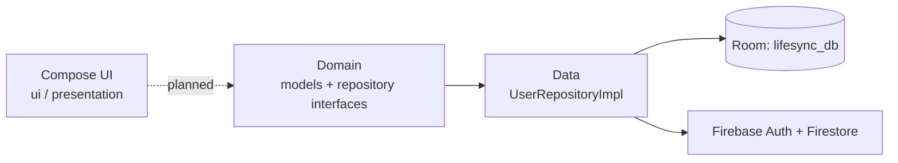

<div align="center">

# Dayweave

An early-stage Android personal-assistant app for tasks, health and daily insights, built with Jetpack Compose.


</div>

> **Status: early prototype.** The app runs and shows the full navigation shell and screen layouts. All values on screen (steps, tasks, sleep, suggestions) are hard-coded placeholders. The data layer is scaffolded but not yet connected to the UI.

## Overview

Dayweave aims to bring task management, health tracking and simple AI-style insights together in one Android app. The current code sets up the UI and the project architecture: Compose screens behind a bottom navigation bar, Hilt dependency injection, a Room database and a Firebase-backed user repository.

## Features

What works in the current build:

- **Five-tab shell**: Home, Tasks, Health, Insights and Profile, behind a Material 3 `NavigationBar` and `LargeTopAppBar`.
- **Home**: Welcome card, daily summary (tasks, steps, water), upcoming activities and suggestion cards.
- **Health**: Daily health summary, workout tracker, nutrition and sleep cards.
- **Insights**: Productivity, health recommendation, habit analysis and assistant summary cards.
- **Tasks**: Task category cards and an add-task floating action button.
- **Polish**: Animated loading screen, slide transitions between tabs, and a custom Material 3 theme.

Scaffolded, but not yet used by the UI:

- **Domain models**: `User`, `Task`, `Activity` and `Health`, plus repository interfaces for each.
- **User repository**: `UserRepositoryImpl` handles Firebase Auth sign-in and sign-up, password reset, email verification and Firestore profile updates.
- **Local storage**: A Room database (`lifesync_db`) with `UserEntity`, `UserDao` and type converters.

## Tech stack

| Layer | Technology |
|-------|------------|
| Language | Kotlin (JVM target 17) |
| UI | Jetpack Compose, Material 3, Material Icons Extended, Navigation Compose |
| DI | Hilt (Dagger 2.50) |
| Local data | Room 2.6, DataStore Preferences |
| Remote | Firebase Auth, Firestore, Analytics, Crashlytics (BoM 33.9.0) |
| Declared, not yet used | Retrofit/OkHttp, Play Services Fitness and Location, WorkManager, Coil |
| Build | Gradle Kotlin DSL, AGP 8.2.2, compileSdk/targetSdk 34, minSdk 30 |

## Architecture

The code follows a Clean Architecture layout:



## Project structure

```
app/src/main/java/com/lifesyncpro/app/
├── MainActivity.kt           # Launcher activity -> MainScreen
├── LifeSyncProApp.kt         # @HiltAndroidApp application
├── di/                       # Firebase, Database, Repository Hilt modules
├── domain/
│   ├── model/                # User, Task, Activity, Health
│   └── repository/           # Repository interfaces
├── data/
│   ├── local/                # Room database, UserDao, UserEntity, converters
│   └── repository/           # UserRepositoryImpl (Firebase)
├── ui/
│   ├── screens/MainScreen.kt # Bottom-nav shell and all tab content
│   ├── components/           # Shared composables and animations
│   └── theme/                # Colors, typography, theme
└── presentation/             # Alternate NavHost-based screens (not the launcher path)
```

## Getting started

### Prerequisites

- Android Studio (Hedgehog or newer) with JDK 17
- An emulator or device running Android 11 (API 30) or newer

### Build and run

```bash
git clone https://github.com/abhiishek340/Dayweave.git
cd Dayweave
./gradlew assembleDebug
```

You can also open the project in Android Studio and run the `app` configuration.

### Firebase

The build applies the Google Services and Crashlytics plugins, so it needs a `google-services.json` in `app/`. To use your own Firebase project, register the package `com.lifesyncpro.app` and replace that file with your own.

## Permissions

The manifest declares Internet, network state, fine and coarse location, activity recognition, camera, storage and body sensors. These are for planned features. The current UI does not request any of them at runtime.

## Notes

- The project was first named "LifeSync Pro", so the package is `com.lifesyncpro.app` and the Gradle root project is `LifeSync Pro`.
- `com.example.myapplication` holds leftover files from the Android Studio template.
- There are no automated tests beyond the template examples.

---

Built by [Abhishek Yadav](https://github.com/abhiishek340)
